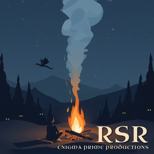

# Enigma's Realistic Smoke Rework

A Valheim mod that makes smoke behave like smoke. It rises, finds its way out of rooms, pools under ceilings, bends in the wind, and reacts to cold and rain. Weak fires puff small and slow. Strong fires pour out big, fast smoke.

## Download

Install from Thunderstore with r2modman or the Thunderstore app:

THUNDERSTORE_LINK_PLACEHOLDER

## Settings

Every setting is explained in [docs/CONFIG_REFERENCE.md](docs/CONFIG_REFERENCE.md). You can change them live in game with Configuration Manager (press F1).

## Bugs and ideas

Open an issue on this page. Please include your BepInEx log (LogOutput.log) and your settings file (EnigmaPrime.RealisticSmokeRework.cfg).

## Support

If you like the mod, you can buy me a coffee:

KOFI_LINK_PLACEHOLDER

## How this mod was made

The ideas, the design, and every decision about how the smoke should look and behave are mine: where it goes, how it reacts to wind and cold, what the settings should be. However, I am not a programmer. The code was written by Claude, an AI assistant made by Anthropic, working from my direction through [Claude Code](https://claude.com/claude-code).

I want to be upfront about that. I am the one who plays the game, so I test every build in Valheim, read the game log for errors, and send back anything that looks or feels wrong until it behaves the way I intended. The code was also checked against Valheim's own code so it hooks in the right places. If you find a bug, please open an issue and I will work on a fix.

Not affiliated with or endorsed by Anthropic.

## License

All rights reserved. You are free to download and use the mod, but please don't redistribute, modify or re-upload it without asking first, see [LICENSE](LICENSE). Valheim is the property of Iron Gate AB and Coffee Stain Publishing. This mod is not affiliated with or endorsed by them.
